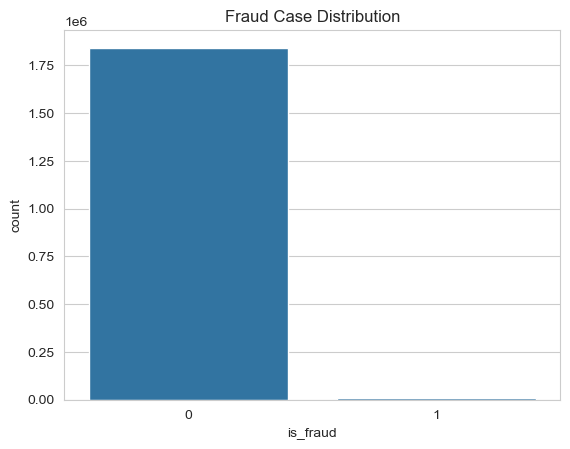
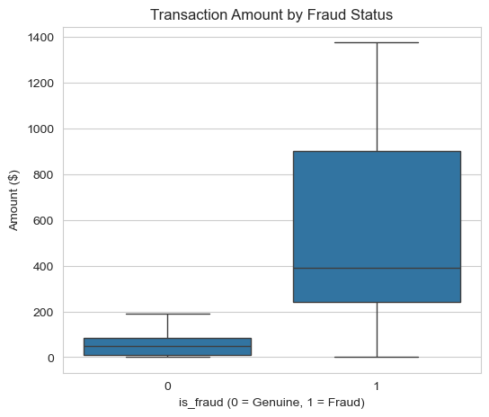
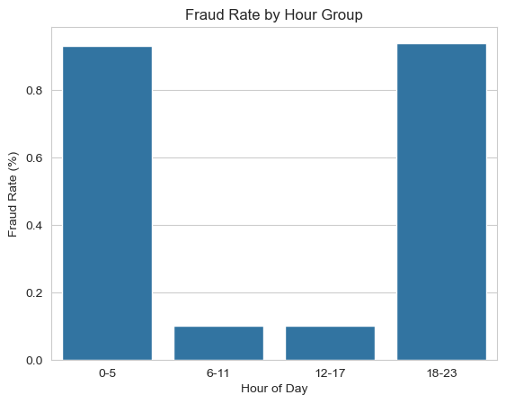
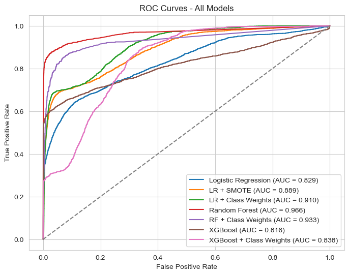
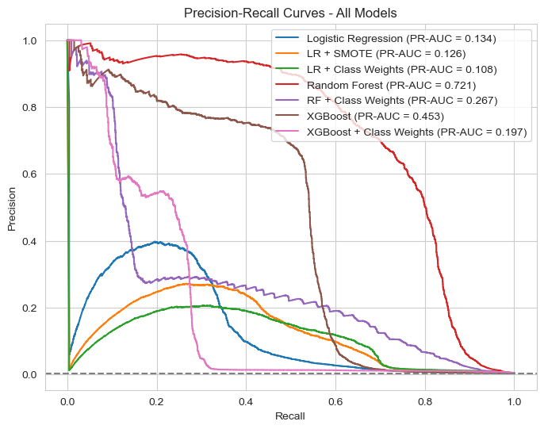

# Credit Card Fraud Detection using Machine Learning

An end-to-end machine learning project that detects fraudulent credit card transactions in a highly imbalanced dataset of **1.85 million transactions**, using **Logistic Regression, Random Forest and XGBoost**. The project covers exploratory analysis, feature engineering, leakage-safe preprocessing, a time-based train-test split, class imbalance handling (SMOTE and class weights), decision threshold analysis and evaluation with metrics designed for rare-event problems.

**Best model: Random Forest, with 93.6% precision, 38.1% recall and a PR-AUC of 0.721 on unseen future transactions.**

---

## Table of Contents
- [Problem Statement](#problem-statement)
- [Dataset](#dataset)
- [Methodology](#methodology)
- [Results](#results)
- [Visualizations](#visualizations)
- [Key Findings](#key-findings)
- [Business Interpretation](#business-interpretation)
- [Limitations and Future Work](#limitations-and-future-work)
- [Repository Structure](#repository-structure)
- [How to Run](#how-to-run)
- [Technologies Used](#technologies-used)
- [Author](#author)

---

## Problem Statement
Credit card fraud is rare but costly: only about 0.5% of transactions are fraudulent, yet each missed fraud is a direct financial loss, while each false alarm inconveniences a genuine customer. The goal is to build models that find the few fraudulent transactions among millions of genuine ones, and to evaluate them honestly on transactions they have never seen.

## Dataset
- **Source:** [Credit Card Transactions Fraud Detection Dataset (Kaggle)](https://www.kaggle.com/datasets/kartik2112/fraud-detection)
- **Type:** simulated credit card transactions, generated with the Sparkov tool, so real-world patterns may differ
- **Period:** 1 January 2019 to 31 December 2020
- **Size:** 1,852,394 transactions and 22 original columns (supplied as separate training and testing files, merged for analysis)
- **Coverage:** 999 unique cards, 693 merchants and 14 merchant categories
- **Target:** `is_fraud` (0 = genuine, 1 = fraud), with only **9,651 frauds (about 0.52%)**

The data files are not included in this repository because of their size (the training file alone is over 300 MB).

## Methodology

### 1. Exploratory Data Analysis
Examined the class imbalance, fraud rate by merchant category, transaction amount, time of day and card numbers. Card numbers were found to carry no reusable fraud pattern (976 of 999 cards had at least one fraud, and fraud rarely repeated on the same card), so they were excluded.

### 2. Feature Selection and Engineering
- Dropped identifiers and redundant columns: `cc_num`, `first`, `last`, `street`, `trans_num`, `zip`, `city_pop` and `unix_time`.
- Created **customer age**, **distance between customer and merchant** (Haversine formula), and **hour, day of week and month** from the transaction time.
- Grouped the hour of the day into four six-hour periods.

### 3. Leakage-Safe Preprocessing
- **Chronological train-test split:** trained on transactions **before 21 June 2020** (1,296,675 rows) and tested on later ones (555,719 rows), which mimics real deployment. A random split would let the model learn from the future.
- **One-hot encoding** for low-cardinality variables (gender, category, day, month, hour group).
- **Target encoding** for high-cardinality variables (state, city, job, merchant), fitted on the training data only with 5-fold cross-fitting and smoothing.
- **Standard scaling**, fitted on the training data only, for Logistic Regression.

### 4. Modelling
- Models: **Logistic Regression** (baseline), **Random Forest** and **XGBoost**.
- Hyperparameter tuning of the Random Forest with **GridSearchCV**.
- Class imbalance handled with **SMOTE** (applied to the training data only) and **class weights** (`class_weight` and `scale_pos_weight`).
- **Decision threshold analysis** for the Logistic Regression models.

### 5. Evaluation
Because accuracy is misleading when 99.5% of transactions are genuine, models were judged on **Precision, Recall, F1-Score, ROC-AUC and PR-AUC**, always on the untouched test set.

## Results

All models were evaluated on the same 555,719 unseen test transactions (2,145 frauds). Precision, Recall and F1-Score use the default threshold of 0.50.

| Model | Precision | Recall | F1-Score | ROC-AUC | PR-AUC |
|---|---|---|---|---|---|
| **Random Forest** | **0.936** | 0.381 | **0.542** | **0.966** | **0.721** |
| XGBoost | 0.766 | 0.328 | 0.460 | 0.816 | 0.453 |
| Random Forest + Class Weights | 0.447 | 0.137 | 0.210 | 0.933 | 0.267 |
| XGBoost + Class Weights | 0.053 | 0.297 | 0.090 | 0.838 | 0.197 |
| Logistic Regression | 0.073 | 0.007 | 0.014 | 0.829 | 0.134 |
| Logistic Regression + SMOTE | 0.263 | 0.334 | 0.294 | 0.889 | 0.126 |
| Logistic Regression + Class Weights | 0.033 | 0.702 | 0.063 | 0.910 | 0.108 |

The **tuned Random Forest** (max depth 20, min samples per leaf 5) reached a precision of 0.935, a recall of 0.322 and an F1-Score of 0.479, which is slightly below the baseline Random Forest.

**Best model, confusion matrix:** 818 frauds detected, 1,327 missed, and only **56 false alarms** among 553,574 genuine transactions.

### Decision Threshold Analysis (Logistic Regression)

| Model | Threshold | Precision | Recall | F1-Score |
|---|---|---|---|---|
| LR + SMOTE | 0.3 | 0.178 | 0.452 | 0.256 |
| LR + SMOTE | **0.5** | **0.263** | **0.334** | **0.294** |
| LR + Class Weights | 0.5 | 0.033 | 0.702 | 0.063 |
| LR + Class Weights | **0.95** | **0.196** | **0.370** | **0.256** |

## Visualizations

### Class Imbalance
Only about 0.5% of transactions are fraudulent, so accuracy cannot be trusted.



### Transaction Amount: Genuine vs Fraud
Fraudulent transactions are far larger (median about 390 USD, compared with about 47 USD).



### Fraud Rate by Time of Day
Fraud is about nine times more likely at night and in the evening.



### ROC Curves (All Models)



### Precision-Recall Curves (All Models)
The Random Forest stays far above every other model, with a PR-AUC of 0.721, about 180 times better than random guessing.



## Key Findings

- **Fraud follows clear patterns.** Online categories and grocery point-of-sale transactions have the highest fraud rates (shopping_net 1.59%, misc_net 1.30%, grocery_pos 1.26%, compared with an overall rate of 0.52%). About **90% of all frauds occur between 18:00 and 05:59**.
- **Accuracy is misleading.** The baseline Logistic Regression had 99.58% accuracy while detecting less than 1% of the fraud.
- **The Random Forest was the best model.** About 94 of every 100 alerts are real fraud, and it disturbs only about 0.01% of genuine transactions.
- **Tree-based models outperform the linear model.** Logistic Regression could not capture the complex fraud patterns, even with SMOTE or class weights.
- **ROC-AUC can flatter a model.** Class-weighted Logistic Regression had a ROC-AUC of 0.910 but a PR-AUC of only 0.108. SMOTE and class weights changed where the model draws the line, not how well it ranks frauds above genuine transactions.
- **Class weights hurt the tree-based models**, and tuning the Random Forest on a sample with shuffled cross-validation did not beat the baseline on future data. Both are reported as they happened.
- **The decision threshold controls the trade-off** between missed frauds and false alarms. Raising the threshold of the class-weighted Logistic Regression from 0.5 to 0.95 improved its F1-Score about four times.
- **Most important features:** transaction amount is the top feature for the Random Forest (about 49% of importance), while XGBoost relies mainly on merchant category (grocery_pos, gas_transport) and the evening time period. Both rank amount, category, evening hours and customer age among the most useful signals.

## Business Interpretation
At the default threshold, the Random Forest is very precise, so almost every alert is worth investigating and very few genuine customers are disturbed. Its weakness is that it detects only about 38% of frauds. The Precision-Recall curve suggests that a lower threshold could catch considerably more fraud while keeping precision reasonably high, so the final threshold would depend on how a business weighs the cost of a missed fraud against the cost of a false alarm.

## Limitations and Future Work

**Limitations**
- The data is simulated, so real-world fraud patterns may differ.
- The fraud rate in the test period (0.39%) is lower than in the training period (0.58%).
- Decision thresholds were explored on the test set to illustrate the trade-off. In practice they should be chosen on a separate validation set.
- Recall is the main weakness of every model. The best model catches 38% of frauds at the default threshold.
- Hyperparameter tuning used a small grid on a 200,000-row sample, and only the Random Forest was tuned.

**Future work**
- Tune the Random Forest's decision threshold on a validation set taken from the end of the training period.
- Add behavioural features such as a card's transaction count in the last hour or its deviation from usual spending.
- Use time-based cross-validation and tune XGBoost more thoroughly.
- Explain individual predictions with SHAP values.
- Evaluate the models using the monetary cost of missed frauds and false alarms.

## Repository Structure
```
Credit_Card_Fraud_Detection/
├── images/                                      # Graphs used in this README
├── Credit_Card_Fraud_Detection_Project.ipynb    # Full notebook with code, outputs and explanations
├── Credit_Card_Fraud_Detection_Project.html     # HTML copy of the notebook (download to view)
├── requirements.txt                             # Python libraries needed
├── .gitignore
└── README.md
```

## How to Run

**To view the analysis:** open `Credit_Card_Fraud_Detection_Project.ipynb` on GitHub. The code, outputs, charts and explanations are all visible, so nothing needs to be installed.

**To run it yourself:**

1. Clone the repository and install the requirements:
   ```bash
   git clone https://github.com/ishikagarwal2002/Credit_Card_Fraud_Detection.git
   cd Credit_Card_Fraud_Detection
   pip install -r requirements.txt
   ```
2. Download `fraudTrain.csv` and `fraudTest.csv` from the [Kaggle dataset](https://www.kaggle.com/datasets/kartik2112/fraud-detection).
3. Open the notebook and, in the **Loading the Dataset** cell, change the two file paths to the location of your downloaded files:
   ```python
   df_1 = pd.read_csv("path/to/fraudTrain.csv")
   df_2 = pd.read_csv("path/to/fraudTest.csv")
   ```
4. Run all cells. Training the Random Forest, GridSearchCV and XGBoost on 1.3 million rows takes a while.

## Technologies Used
Python, pandas, NumPy, Matplotlib, Seaborn, scikit-learn, XGBoost, imbalanced-learn, Jupyter Notebook

## Author
**Ishika Agarwal**
[LinkedIn: https://www.linkedin.com/in/ishika-agarwal2901/] 
